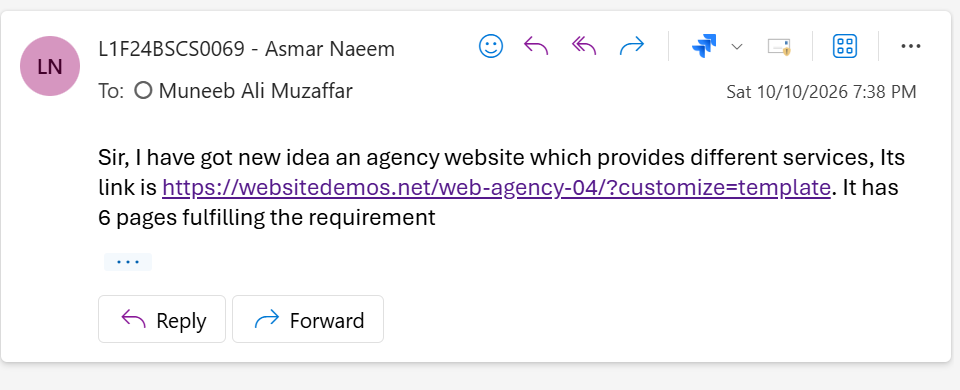

# Web-Agency--L1F24BSCS0069-
A responsive web agency website showcasing services (UI/UX, branding,), portfolio, blog, careers, and quote and contact pages. Built with a clean, conversion focused design.

# Proof Of Project
I have gotte Persmisiion from my Web Technologies Sir in class and i have also mailed my idea to my Sir.
 

# AI Decleration
1. I brain-stormed ideas using chatgpt. 
2. I made a plan to build my website using chatgpt and used gemini to get latest info from offical documentation of the tags.